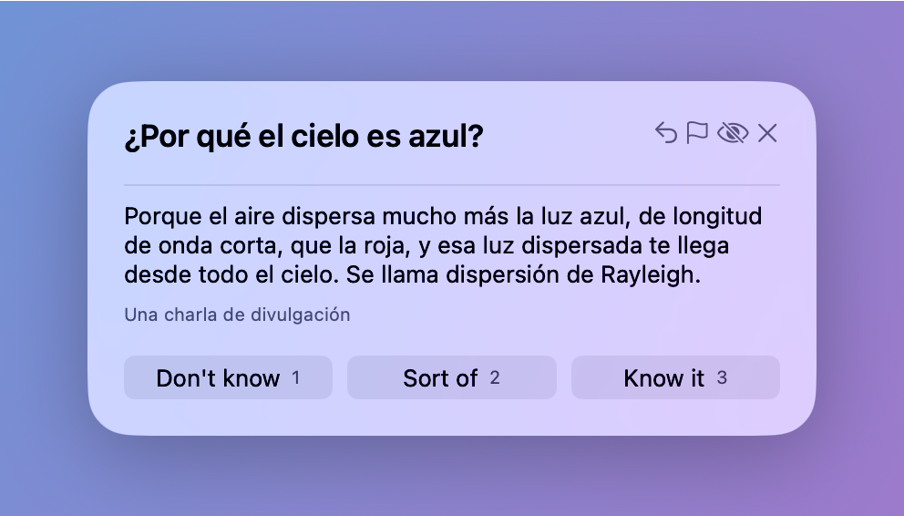
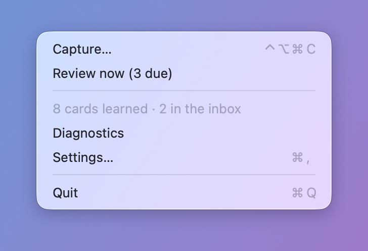
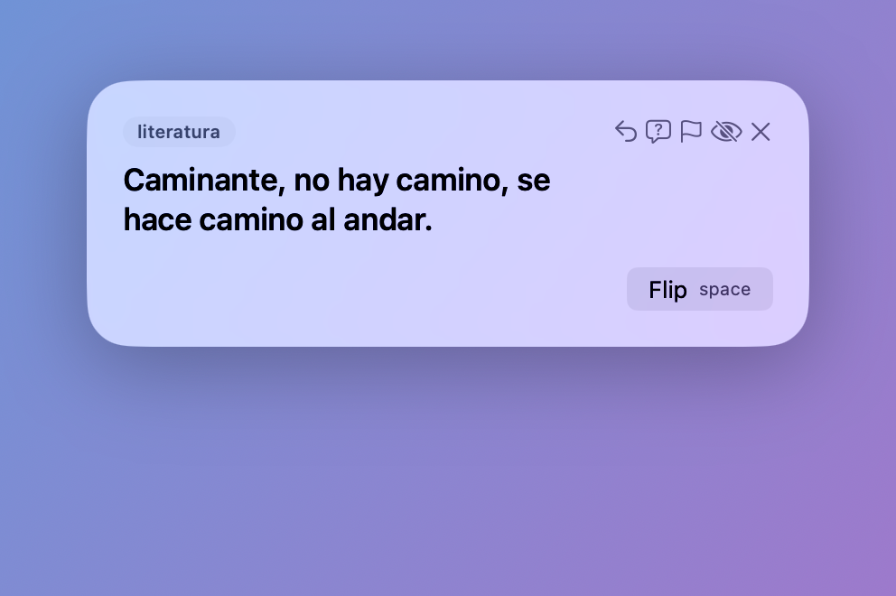
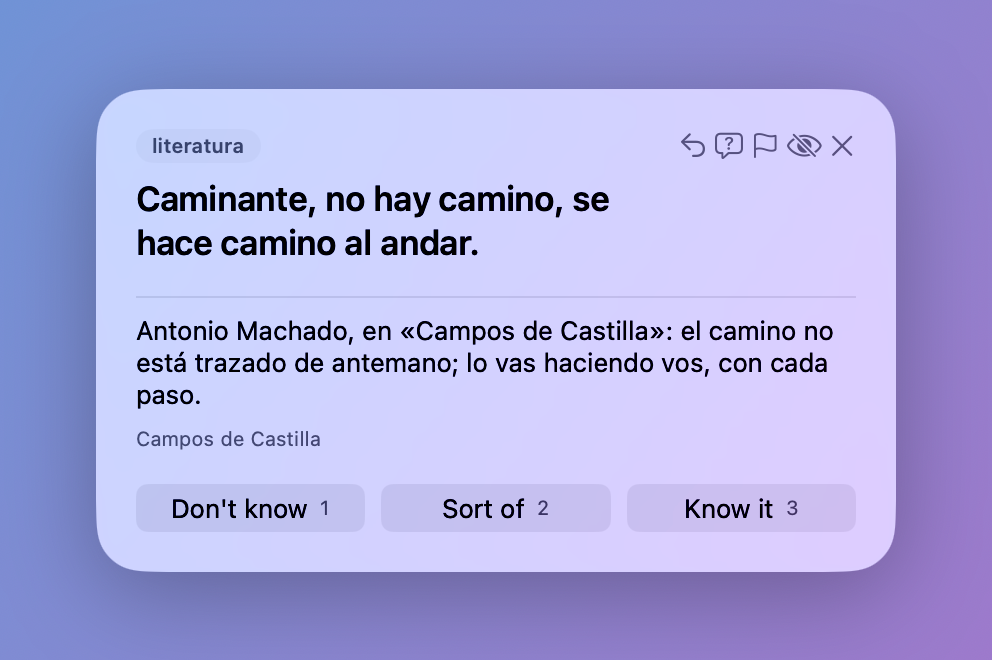
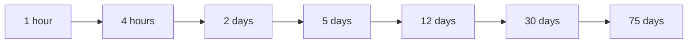
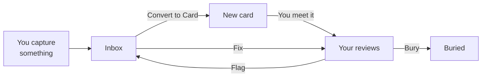
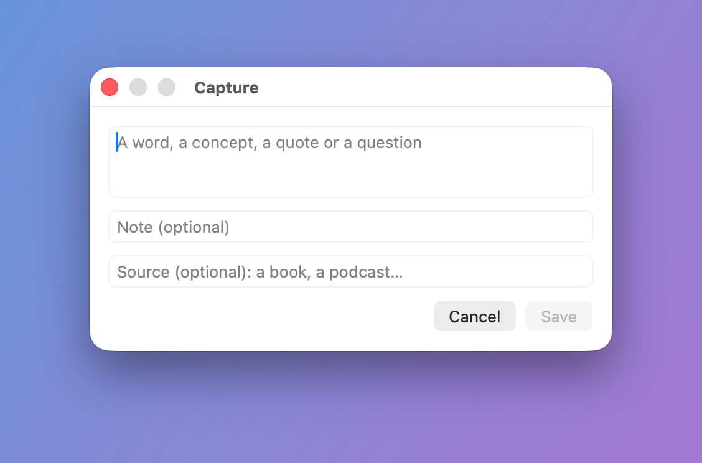

# Ficha

Ficha is a small Mac app that lives in the menu bar and, every so often, shows you a tiny card: a word, a concept, a quote or a question. You flip it, say how well you knew it, and go back to what you were doing. Each card comes back around when you'd start to forget it: soon while it's new to you, and less and less often as you learn it. Everything stays on your Mac.

  

The cards in these pictures are samples, in Spanish. Yours can be in any language.

## A card every so often

You don't sit down to study. When some of your cards are due, or a new one is waiting for you, a small panel shows up near the top of the screen with up to five cards: the ones due, and a new one when there's room. It only comes during the day, at least half an hour after the last one, and never during a meeting, a video or a full-screen app. Add Ficha's filter to a Focus in System Settings, turn on "Hold back appearances", and it waits while that Focus is on too.

It doesn't catch what you're typing: it waits until you stop for a moment, or until you click it. If now isn't a good time, press Esc, and the cards wait for the next one. Left alone, it closes after ten minutes.

You can also open it yourself, whenever you like, with "Review now" in Ficha's menu, which says how many cards are due, or from the Shortcuts app, Spotlight or a keyboard shortcut you set there. The menu also shows how many cards you've learned and how many wait in the inbox.

  

In Settings you pick the hours, how many cards come at a time and how far apart, and whether Ficha starts when you log in.

## Flip, then rate

  
  

A card shows its front first. Try to remember what's on the back, press Space to turn it over, and say how you did: 1 for "Don't know", 2 for "Sort of" or 3 for "Know it". It takes a few seconds, and every button has its key, so you never need the mouse. The first time you meet a card, it shows whole, marked "New": read it and press Enter.

A card can also go both ways, as a word and its translation do. Once you've met it, it comes back first too, marked "Back first": the back on top, and you try to remember the front. Each way climbs the ladder on its own. The first time it comes back first, turn it over with Space, read it and press Enter.

A side with a sound shows a ▶ under it. A sound never plays on its own: press R to hear the card's, the lower side's once you've turned it over, or the upper side's when the lower one has none, or click a side's ▶. Press R or the ■ again to stop it. It keeps playing as you turn the card over, and stops as you answer the card, write about it or leave it, and as the panel closes.

When a card is wrong or unclear, press M and write what to fix: it leaves your reviews until it's fixed, and then comes back where it was. A card you keep forgetting is often a badly written one, so the eighth time you answer "Don't know" to it, Ficha offers to flag it, its note already saying so: press Enter to flag it, or Esc to keep it. Settings changes that number, or turns the offer off. When you no longer want a card, press E to bury it, and it won't show up again. When a card makes you wonder something, press A and write your question: it waits in the inbox as a follow-up, tied to the card, to become new cards, and the card stays in front of you. ⌘Z undoes the last thing you did, and then the one before.

## Why each card waits its own time

Memory fades unless you go back to what you learned, and each time you recall something just as it's slipping away, it lasts longer. So reviewing a card you know well every day is wasted time, and leaving one you barely know for a month means starting over. This is spaced repetition, the idea behind many flashcard apps.

Ficha spaces each card on a ladder of waits, like the Leitner system, a classic way to space flashcards:

A new card starts on the first step. "Know it" moves it one step up, so it waits longer before it comes back. "Sort of" keeps it where it is, and "Don't know" sends it back to the first step. A card that waits 30 days or more counts as learned, and still comes back now and then, so you keep it.

Many flashcard apps work out a different wait for each card with a formula. Ficha's ladder is simpler: you can always tell why a card shows up today. Its steps can be changed in Settings.

## Your cards

Ficha's Cards window lists all your cards, and it's where they come in and go out.

**New Card.** Write a card yourself: its front and back, the deck it goes in, and if you like its tags, a type, where it comes from, and Both ways, so that it comes back first too. As in Anki's Add window, the deck starts as the one you're looking at in the sidebar, or else the one you last added a card to on this Mac, and New Deck… there makes another. The form stays open for the next card, and tells you when a front repeats one of your cards. Editing a card can move it to another deck too.

**Import.** Bring in cards you made elsewhere: a text file with one card per line, which a spreadsheet saves, Anki exports as "Notes in Plain Text", or an AI writes, zipped with its images and sounds when its cards have any. You choose the deck its cards come into, or a "Deck" column puts each card in its own, as in the file Anki exports with "Include deck name" ticked. A "Both ways" column with any text in it makes its card go both ways, as Anki's "Add Reverse" field does. The Import sheet copies [instructions for an AI](docs/instructions-for-an-ai.md) to paste into yours, so that it writes the file for you. It also takes a deck Anki exports as a package (`.apkg`), its cards in Anki's decks and with its notes' tags, which you can rename before they come in, a deck with the decks inside it, with its images and sounds, a video's sound included, and, if you like, its progress: each card you had studied comes in on the step of your ladder nearest where Anki had it, due when Anki had it due, and the ones you had suspended come in buried. A note of Anki's "Basic (and reversed card)", or of its "Basic (optional reversed card)" with text in "Add Reverse", comes in as one card that goes both ways, each way with its own Anki card's progress; with its progress, it comes in with Both ways off when you had suspended only its reversed card. Before anything comes in, Ficha shows how many cards the file holds, which repeat yours, and which lines it couldn't read, and it saves a copy of your cards, so restoring it undoes the import.

**Export.** Save the selected cards, a deck's cards, with those of the decks inside it, a tag's cards, with those of the tags inside it, or all of them to that same kind of file, to pass them on: another Ficha imports it, and Anki too. When a card has an image or a sound, the file goes in a zip with the images and sounds, which another Ficha imports whole. It holds what the cards say, the deck each one lives in, in a "Deck" column Anki reads too, and which ones go both ways, in a "Both ways" column that Anki can take as its "Add Reverse" field, but never your progress.

## From something you read to a card

Many cards come from what you come across: a word in a book, a line in a podcast, a question you couldn't answer.

**Capture.** When something catches your eye, jot it down with "Capture…" in the menu, or with a keyboard shortcut from any app. Just the text, with a note or where you found it if you like. It waits in the inbox, and you go back to what you were doing. If it repeats a card you already have, Ficha asks whether to add it to that card.

  

**Convert to Card.** When you have a moment, pick a capture in the Cards window's inbox and convert it: the card form opens beside what you jotted down, for one card or several, each in the deck you choose there, and the capture leaves the inbox once you close the form. A follow-up, what you asked about a card in the review panel, shows with its card, and its new cards start in that card's deck, with its tags, so they land beside it.

**Refine.** Lucas, who builds Ficha, turns his own captures into cards another way, outside the app: he goes through his inbox with Claude, Anthropic's AI assistant, in a session he starts. Claude drafts cards for each capture, following [a guide](docs/content-guide.md) for how Lucas's cards are written, and proposes which of them go both ways, a fix for each card he flagged, and where an image or a sound he points to goes. Nothing becomes a card without his OK.

## Everything stays on your Mac

Ficha has no account, no sync and no tracking, and it never connects to the internet. Your cards are kept on your Mac and nowhere else. Ficha backs them up on its own, once a day unless you pick another frequency, in a folder next to them, and Settings' Backups tab lists the copies and restores any of them. There's no AI inside the app either: an AI sees your cards only if you give them to it, and its cards come in only when you import its file.

---

To build and run Ficha from its source, see [the development guide](docs/development.md).
