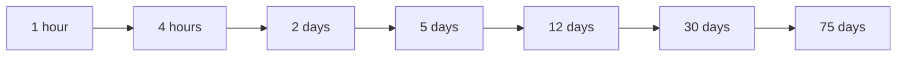
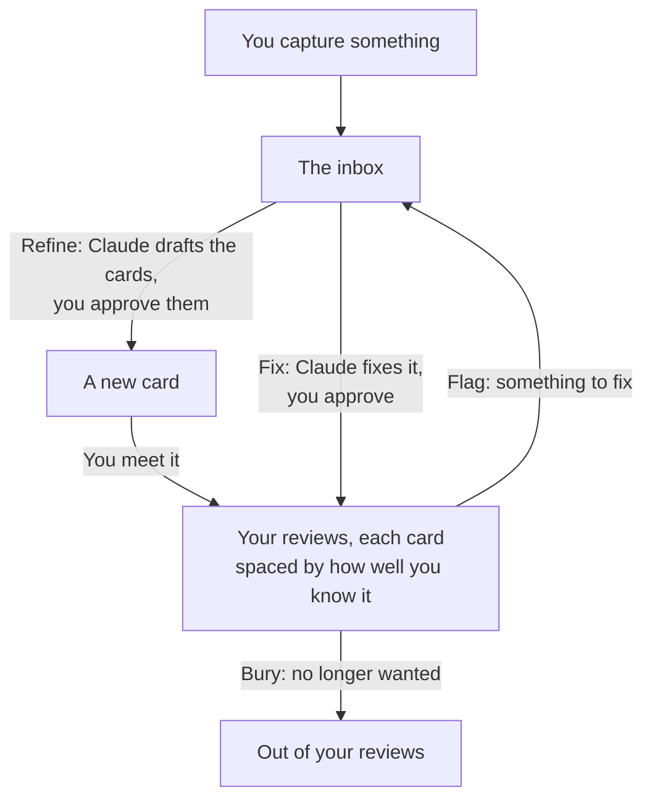

# Ficha

Ficha is a small Mac app that lives in the menu bar and, every so often, shows you a tiny card: a word, a concept, a quote or a question. You flip it, say how well you knew it, and go back to what you were doing. Each card comes back around when you'd start to forget it: soon while it's new to you, and less and less often as you learn it. Everything stays on your Mac.

  

The cards in these pictures are samples. Ficha's cards are in Spanish.

## A card every so often

You don't sit down to study. When some of your cards are due, or a new one is waiting for you, a small panel shows up near the top of the screen with up to five cards: the ones due, and a new one when there's room. It only comes during the day, at least half an hour after the last one, and never during a meeting, a video or a full-screen app.

It doesn't catch what you're typing: it waits until you stop for a moment, or until you click it. If now isn't a good time, press Esc, and the cards wait for the next one. Left alone, it closes after ten minutes.

You can also open it yourself, whenever you like, with "Review now" in Ficha's menu. The menu also shows how many cards you've learned and how many wait in the inbox. In Settings you pick the hours, how many cards come at a time and how far apart, and whether Ficha starts when you log in.

## Flip, then rate

  
  

A card shows its front first. Try to remember what's on the back, press Space to turn it over, and say how you did: 1 for "Don't know", 2 for "Sort of" or 3 for "Know it". It takes a few seconds, and every button has its key, so you never need the mouse. The first time you meet a card, it shows whole, marked "New": read it and press Enter.

When a card is wrong or unclear, press M and write what to fix: it leaves your reviews until it's fixed, and then comes back where it was. When you no longer want a card, press E to bury it, and it won't show up again. ⌘Z undoes what you did with the last card.

## Why each card waits its own time

Memory fades unless you go back to what you learned, and each time you recall something just as it's slipping away, it lasts longer. So reviewing a card you know well every day is wasted time, and leaving one you barely know for a month means starting over. This is spaced repetition, the idea behind many flashcard apps.

Ficha spaces each card on a ladder of waits, like the Leitner system, a classic way to space flashcards:

A new card starts on the first step. "Know it" moves it one step up, so it waits longer before it comes back. "Sort of" keeps it where it is, and "Don't know" sends it back to the first step. A card that waits 30 days or more counts as learned, and still comes back now and then, so you keep it.

Many flashcard apps work out a different wait for each card with a formula. Ficha's ladder is simpler: you can always tell why a card shows up today. Its steps can be changed in Settings.

## From something you read to a card

Ficha's cards come from what you come across: a word in a book, a line in a podcast, a question you couldn't answer.

**Capture.** When something catches your eye, jot it down with "Capture…" in the menu, or with a keyboard shortcut from any app. Just the text, with a note or where you found it if you like. It waits in the inbox, and you go back to what you were doing. If it repeats a card you already have, Ficha asks whether to add it to that card.

  

**Refine.** Now and then, you go through the inbox with Claude, Anthropic's AI assistant, in a session you start. Claude drafts cards for each capture, short and in plain Spanish, following [a guide](docs/content-guide.md) for how Ficha's cards are written. It also proposes a fix for each card you flagged, and can bring back a card you buried. You approve, change or turn down each proposal: nothing becomes a card without your OK.

## Everything stays on your Mac

Ficha has no account, no sync and no tracking, and it never connects to the internet. Your cards are kept on your Mac and nowhere else. There's no AI inside the app either: Claude only sees your cards in a refine session you start, and changes only what you approve.

---

To build and run Ficha from its source, see [the development guide](docs/development.md).
